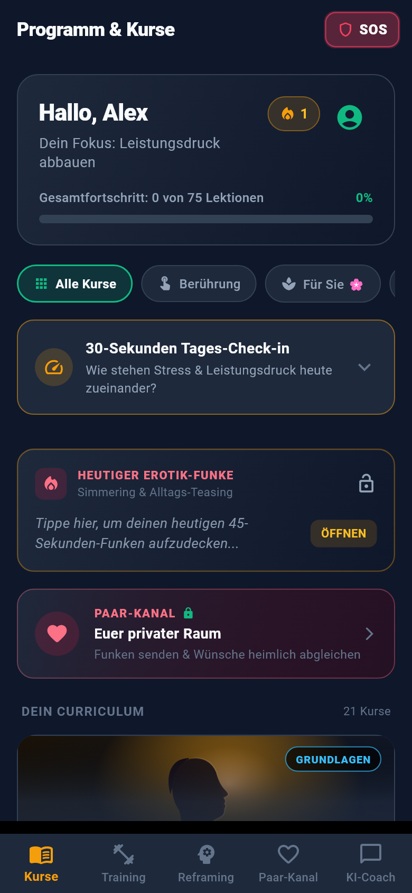
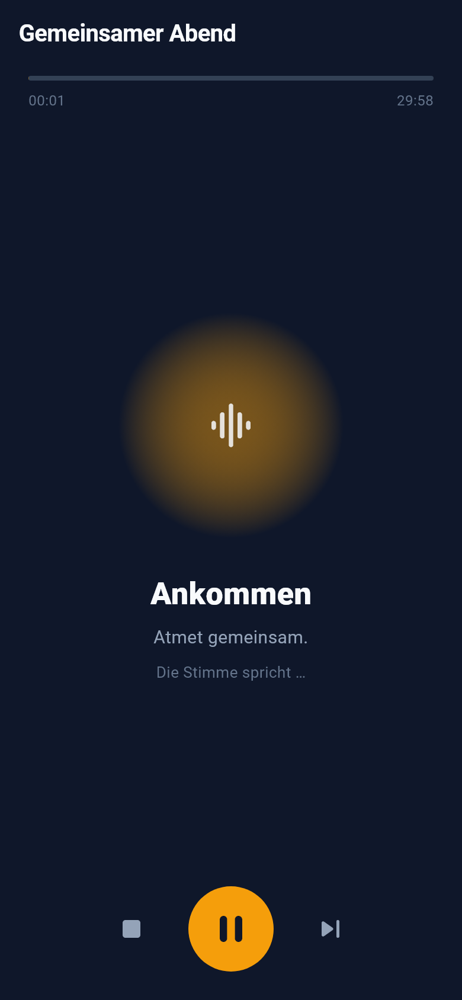
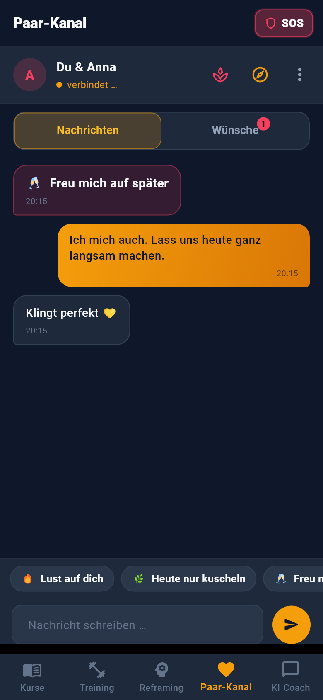
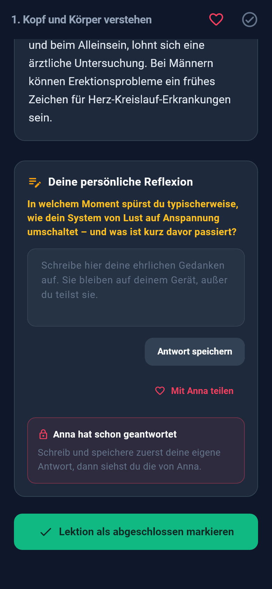
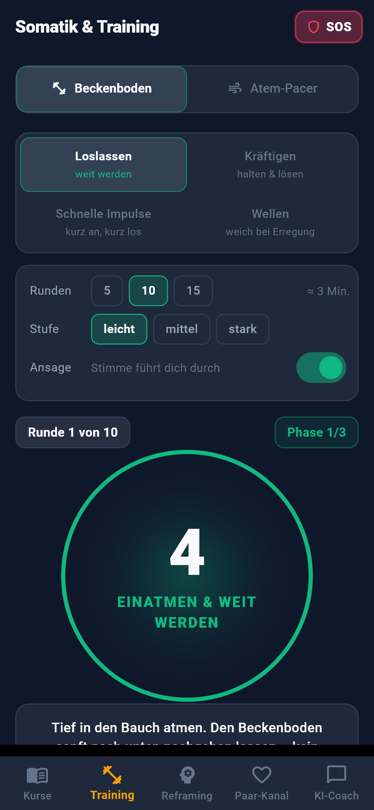

# VelvetPulse

> **Intimacy without performance pressure: courses, body exercises and an encrypted couple channel.**
> For her, for him and for couples · open source · no account, no tracking, no server of our own

[](https://github.com/angemann-app/velvet_app/releases/latest)
[](https://github.com/angemann-app/velvet_app/actions/workflows/tests.yml)
[](LICENSE)
[](LICENSE-CONTENT.md)
[](https://github.com/angemann-app/velvet_app/releases/latest)
[](https://github.com/nostr-protocol/nips/blob/master/04.md)
[](translations/en/)

[Deutsch](README.de.md) · **English**

> 🇩🇪 **Made in German:** VelvetPulse was written in German, and German remains the app's original language
> and the default on German phones. Everything is fully translated into English, and the app follows your
> phone's language (you can switch in the profile).
>
> 🌍 **Help translate:** more languages are very welcome, and you don't need to be a developer.
> See [CONTRIBUTING.md](CONTRIBUTING.md) to get started.
>
> 🗣️ **Does a word sound wrong?** If the voice mispronounces a word, please report it using
> [this template](https://github.com/angemann-app/velvet_app/issues/new?template=aussprache.md).

VelvetPulse is an Android app for fulfilling sexuality and closeness. It combines **cognitive behavioural
therapy (CBT)**, **somatic body work** and **sex education**: first understand why the body puts on the
brakes, then take your foot off the brake with exercises, breathing and touch, on your own or together.

<p align="center">
  
  
  
  
  
</p>

**[⬇ Download the latest version](https://github.com/angemann-app/velvet_app/releases/latest)** ·
[How to install (German)](docs/TESTER.md) · [How the app works](docs/GUIDE.md) · [Anleitung (Deutsch)](docs/ANLEITUNG.md)

> **Note:** The app is meant for adults and contains frank educational content about sexuality.
> It does not replace medical or psychotherapeutic treatment. Where it matters medically, the lessons
> say explicitly when it's wise to see a doctor.

The recordings (German and English) are downloaded inside the app as packs; until then, your phone's voice reads aloud.

## Features

### Courses and lessons
- **27 courses with 124 lessons** (25 of them only in spicy mode):
  - *Foundations* (courses 1–6): the two-pedal model, anatomy of arousal, every body is beautiful, the spectator trap, pain, shame and performance pressure, presence and self-compassion.
  - *Body and self* (courses 7–11): pelvic floor, exploring yourself, female desire, resetting stimuli, prostate and perineum.
  - *Relationship and everyday life* (courses 12–16): breaking the silence, mismatched desire, life phases
    (birth, menopause, ageing, illness), anticipation and slowness, everyday eroticism.
  - *Touch and practice* (courses 17–22): the couple lab, touch for her and for him, intimate massage, voice and breath, relaxed positions.
  - *Fantasy and play* (courses 23–25): fantasies and surrender, scenarios for two, toys.
  - *Spicy* (courses 26–27, spicy mode only): Spicy solo and Spicy for two.
- **Spicy mode (18+, optional):** switched on in the profile, it unlocks two levels for the guided audios
  (spicy and very spicy), two courses of its own, spicy lessons in ten more courses, 13 more
  yes/maybe/no items, and in the couple chat hot sparks, disappearing messages, photos and an optional
  photo idea of the day. Without it, none of this is visible.
- Every lesson follows the same structure: **Why it works** · **The exercise** ·
  **Consent and safety** · where needed **When to see a doctor**.
- **Audio for every lesson** (voiced by Victoria and Martin, downloaded once as a pack, then offline).
- **Illustrations**: tap to open them full screen with zoom.
- **My desire profile:** note down what you like and, if you want, send it to your partner.

### An evening together
- Guided touch for two, **20, 30 or 45 minutes**, clothed, skin to skin or intimate.
- Every evening is assembled anew from 110 spoken building blocks: arriving, two rounds with
  role swap, winding down, with a singing bowl and a soft sound bed during the silences.

### Guided self-exploration
- Time just for you, **10, 20 or 30 minutes**: arriving, breathing and a journey across your own body,
  gentle, with bare skin or intimate, for vulva or penis, with Victoria or Martin.
- Also assembled anew every time, from 100 building blocks.
- Both are right at the top of the home screen.

### Drift-off journey
- A long, quiet companion into sleep, **60, 90 or 120 minutes**, with a focus of your choice (my body is welcome,
  desire is a wave, gas pedal and brake, feeling instead of watching, a soft pelvis, I may enjoy) or as a surprise.
- The voice grows quieter and rarer, the sentences return in rounds, and at the end only a soft sound fades out.
  In spicy mode with calmer but more explicit words for vulva or penis. No couple mode.

### Training and quick help
- **Pelvic floor timer** with four exercise types (release, strengthen, pulses, waves) and voice prompts.
- **Breathing pacer** (including 4-7-8 breathing and the physiological sigh).
- **SOS button** with checklists for *before*, *in the moment* and *afterwards*.
- **Reframing journal** based on CBT and a daily 30-second check-in.

### Couple channel
- **Invite your partner** straight from the app or connect by **QR code**, with no account and no phone number.
- **Sparks:** one tap says what you're in the mood for today, or that you're not.
- **Match wishes privately:** 65 ideas in 10 areas (13 more in spicy mode); only what you both want
  becomes visible.
- **Learn together:** share lessons and exchange reflections; your partner's answer only appears
  once you've answered yourself.
- **In spicy mode:** messages that disappear ten minutes after reading, and **photos** (experimental)
  that travel encrypted directly from phone to phone and can be viewed only once. If your partner isn't
  online, the photo waits encrypted on your own phone for up to seven days.
- **Notification of new messages**, even when the app is closed, without content and without names.
- Connected to all Nostr relays at once; every message is checked for signature and sender.

### Discretion and updates
- **App lock by fingerprint**; content is hidden in the app switcher.
- **Discreet app icon** "Pulse" if you like.
- **Updates directly in the app** from the GitHub releases, with checksum verification;
  choose **stable** or **beta**.

### AI coach (optional)
- A confidential conversation partner via **Google Gemini** with your own API key (*bring your own key*).

## Privacy

| What | Where |
|---|---|
| Profile, progress, journal, check-ins | only on the device (`SharedPreferences`), unencrypted in the app's private storage |
| API key, couple channel private key | encrypted in the Android Keystore, not in the cloud backup and not in the normal backup |
| Automatic backup | the app's private storage (not readable by other apps), without secrets, backed up via Android's cloud backup |
| Photos in the couple chat | encrypted with AES-256-GCM, directly from phone to phone (WebRTC). To set up the connection, a public STUN server run by Google sees the IP addresses, never the photo. Viewable only once by the recipient, screenshots blocked. |
| Couple channel | NIP-04 encrypted over public Nostr relays. They cannot read the content, but they can see the public keys of sender and recipient, the time and size of every message, the IP address and, for read receipts, that an app entry was updated. Incoming messages are checked for ID, signature, recipient and sender. |
| Feedback (*Send feedback*) | only what you type, plus app version and language, NIP-04 encrypted over the Nostr relays to the project's feedback inbox, from a fresh one-time key with no link to the couple channel. The relays see the IP address, not the content. |
| AI coach | messages, name, age, gender, relationship status and focus are sent to Google Gemini, only if you add your own API key |

There are no user accounts, no tracking and no server of our own.
The fingerprint lock protects access to the app; it does not encrypt stored data.

**Backups** (*Profile → Export backup*): "Data only" contains no secrets. "With password" also includes the
couple connection and API key, encrypted with PBKDF2-SHA256 and AES-256-GCM. The password is not stored
in the backup. Files in Download or Documents are never read in automatically.
After restoring from Google's cloud backup, the couple channel has to be paired again.

## Adding a Gemini API key (optional)

1. Sign in to [Google AI Studio](https://aistudio.google.com/).
2. Choose **Get API key → Create API key**.
3. In the app, open the **AI coach** tab, tap the settings icon and paste the key.

## Development

### Requirements
- [Flutter SDK](https://flutter.dev/docs/get-started/install) (Dart ≥ 3.0)
- JDK 17
- Android SDK
- For releases: [GitHub CLI](https://cli.github.com/) (`gh auth login`)
- For generating audio: Python 3.10–3.13 and `ffmpeg`

### Run and build
```bash
flutter pub get
flutter run
```

Release APK for testing (per architecture, smaller):
```bash
flutter build apk --release --split-per-abi --build-number <N>
```
The APKs end up in `build/app/outputs/flutter-apk/`.

### Publishing a release (updates for testers)
On start, the app checks the [GitHub releases](https://github.com/angemann-app/velvet_app/releases) once a day
and offers new versions for installation (`lib/services/update_service.dart`).
```bash
powershell -ExecutionPolicy Bypass -File tools\release.ps1 -Version 4.5.0 -Build 30 -Notes "New: …"          # stable
powershell -ExecutionPolicy Bypass -File tools\release.ps1 -Version 4.5.0-beta.1 -Build 29 -Notes "…" -Beta  # beta
```
The script builds the app, creates `velvetpulse-<abi>.apk` with a `.sha256` checksum for each architecture
and publishes the release with the tag `v<version>+<build>` via the [GitHub CLI](https://cli.github.com/).
The build number must increase with every release, across beta and stable; the script checks this and
runs all tests first.

### Signing key
Releases are signed with a key of their own. It is created once with `tools\schluessel_erstellen.ps1`
and included via `android/key.properties` (not in the repository). Without this file the app builds with
the debug key, and the release script stops.

> **Never lose the key or its password.** Android only installs updates signed with the same key.
> Without it, all users would have to uninstall and reinstall the app.

> **Build notes**
> - Increase the build number with every update. With `--split-per-abi` it becomes version code 2000 + N (arm64);
>   a lower version code is rejected by the device as a downgrade.
> - Code minification (R8) is deliberately **off** in release builds: `shared_preferences` calls Kotlin code via
>   JNI, which R8 would otherwise remove, and the app could no longer save anything.
> - `MainActivity` is a `FlutterFragmentActivity` and the themes inherit from AppCompat; the fingerprint lock
>   (`local_auth`) needs both.

### Tests
```bash
flutter test                                   # start-up flow, security, couple channel, planners
flutter test test_screens/screens_test.dart    # renders every screen as PNG into build/screens/
flutter test test_screens/screens_test.dart --dart-define=SCALE=2   # at double resolution (README)
```
The screenshot test also reports layout overflows per screen. Live tests against real Nostr relays
live in `test_live/` and don't run automatically. `dart run tools/relays_pruefen.dart` checks whether the
relays pass on direct messages.

### Content and media

| File / tool | Purpose |
|---|---|
| `assets/data/velvet_content.json` | all courses, lessons, SOS cards and beliefs (German original) |
| `assets/audio/` | source of all German recordings; not bundled in the APK except the pelvic floor cues (`cues/`, English in `cues_en/`), singing bowl and sound bed. The rest ships as packs |
| `tools/pakete_hochladen.ps1` | build the audio packs (`tools/pakete_bauen.py`, versions in `tools/pakete/versionen.json`), sign the index `audio-index.json` (`tools/pakete_verzeichnis.dart`, key outside the repo), upload to the GitHub release `pakete` and copy to Cloudflare R2 (workflow `pakete-nach-r2.yml`) |
| `tools/generate_audio.py` | re-record lessons, e.g. `tease_1` or `--courses 8-17` (see below) |
| `tools/aussprache.json` | pronunciation dictionary for individual words |
| `translations/en/` | English version of all content, shipped with the app; every change to a German text must be carried over there, otherwise `test/translation_test.dart` fails |
| `lib/l10n/app_de.arb`, `app_en.arb` | interface texts (Flutter gen-l10n, accessed as `t.<key>`); `test/oberflaeche_texte_test.dart` checks completeness |
| `tools/l10n_umzug.py`, `tools/arb_setzen.py` | move fixed texts from the code into the ARB files, or set individual entries |
| `tools/generate_audio_en.py` | record and pack the English audio pack (downloaded in the app) |
| `tools/translations.py` | translation helper for English: skeleton, text export, import |
| `translations/po/`, `translations/STATUS.md` | PO files for translators and the progress per language; refresh with `flutter test test/uebersetzung_test.dart --dart-define=PO=sync` ([guide](translations/README.md)) |
| `tools/generate_covers.py` | regenerate the course images `assets/images/cover_NN.svg` |
| `assets/images/diagram_*.svg` | illustrations (800×600) |

### Re-recording audio
The lessons are generated **locally** with [Kokoro](https://github.com/hexgrad/kokoro) and German community voices:
[Victoria](https://huggingface.co/kikiri-tts/kikiri-german-victoria) for the "For her" courses,
[Martin](https://huggingface.co/kikiri-tts/kikiri-german-martin) for all others (both Apache-2.0).
After every text change to a lesson, its audio should be regenerated.

One-time setup of a separate Python environment (the German Kokoro forks):
```bash
python -m venv C:\TOOLS\kikiri-venv
C:\TOOLS\kikiri-venv\Scripts\python.exe -m pip install torch --index-url https://download.pytorch.org/whl/cpu
C:\TOOLS\kikiri-venv\Scripts\python.exe -m pip install huggingface_hub soundfile numpy espeakng-loader edge-tts "git+https://github.com/semidark/misaki.git@6d252a2e02f3b030f22f56686f1a73786c16ffc8" "git+https://github.com/semidark/kokoro.git"
```
Recording and checking pronunciation:
```bash
C:\TOOLS\kikiri-venv\Scripts\python.exe tools\generate_audio.py tease_1
C:\TOOLS\kikiri-venv\Scripts\python.exe tools\generate_audio.py --zeige "Pedal" "liefern"
```
If a word sounds wrong, its phonetic spelling goes into `tools/aussprache.json`. With `--engine edge`, Microsoft
Edge TTS is used instead; the text is then sent to Microsoft's service.

## License

- **Code:** [MIT](LICENSE)
- **Content** (texts, audio, images, documentation): [CC BY-NC-SA 4.0](LICENSE-CONTENT.md):
  sharing and adapting allowed, with attribution, non-commercial and under the same terms.
