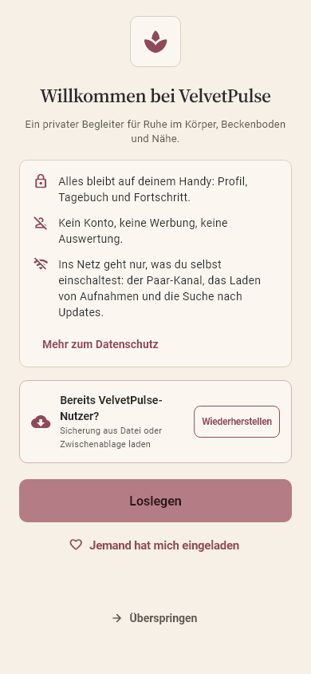
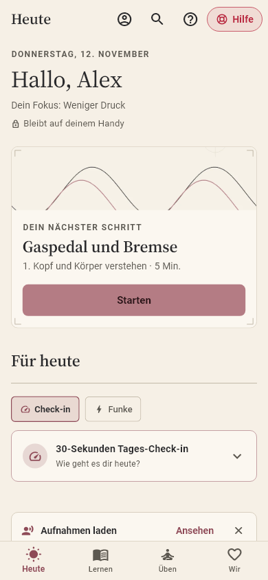
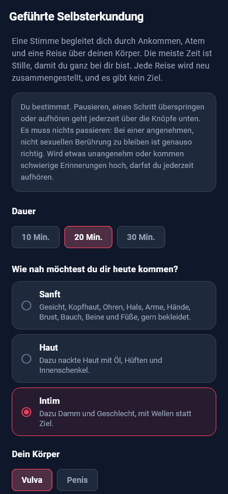
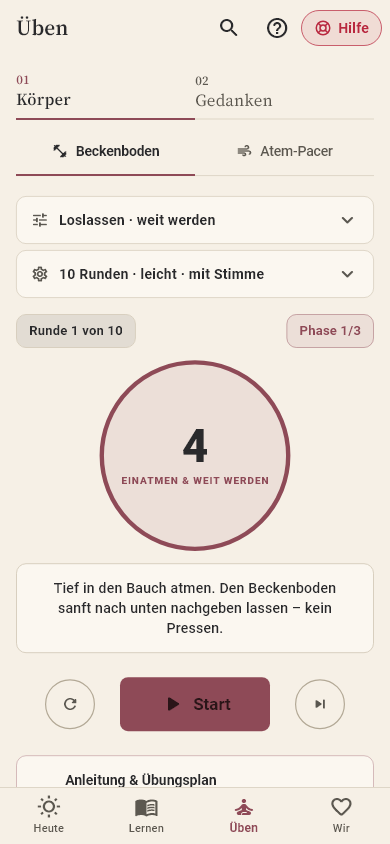
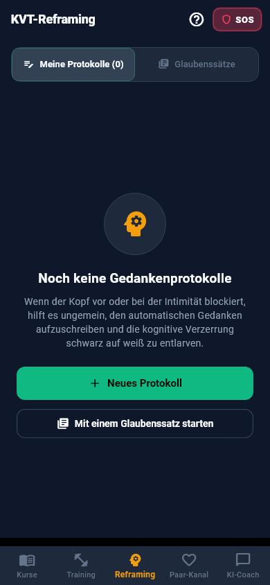
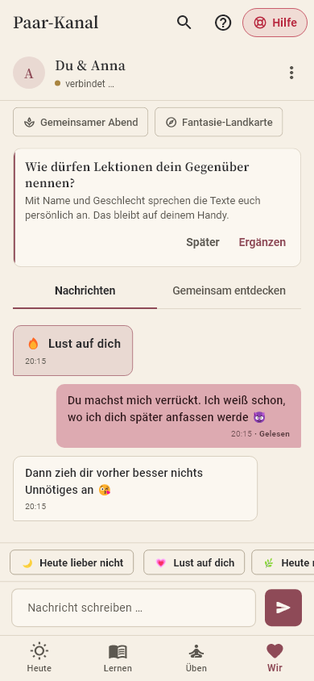
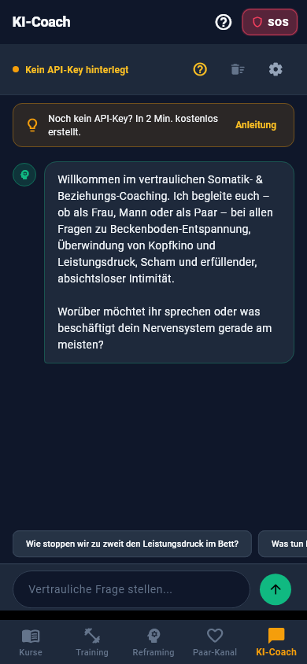
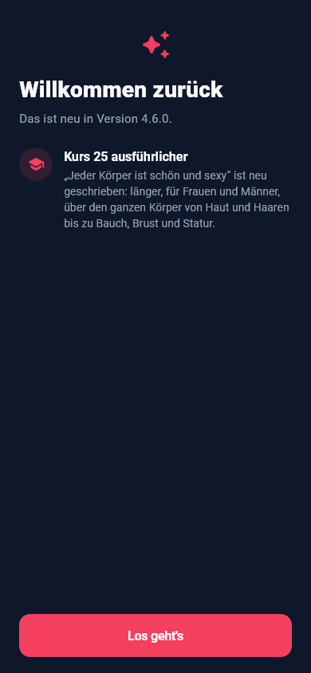

# So funktioniert VelvetPulse

Diese Anleitung steht auch in der App (Fragezeichen oben rechts oder im Profil). [English version](GUIDE.md)

## Inhalt

- [Erste Schritte](#erste-schritte)
- [Kurse und Lektionen](#kurse-und-lektionen)
- [Finden und dein persönlicher Weg](#finden-und-dein-persönlicher-weg)
- [Weiterhören und gemeinsam erleben](#weiterhören-und-gemeinsam-erleben)
- [Geführte Audios](#geführte-audios)
- [Training und Akuthilfe](#training-und-akuthilfe)
- [Reframing-Tagebuch und Check-in](#reframing-tagebuch-und-check-in)
- [Paar-Kanal](#paar-kanal)
- [Spicy-Modus (ab 18)](#spicy-modus-ab-18)
- [KI-Coach](#ki-coach)
- [Datenschutz, Diskretion und Sicherung](#datenschutz-diskretion-und-sicherung)
- [Updates und Beta](#updates-und-beta)
- [Sprache und englische Aufnahmen](#sprache-und-englische-aufnahmen)
- [Darstellung](#darstellung)
- [Hilfe und Rückmeldung](#hilfe-und-rückmeldung)
- [Schlafdaten vergleichen](#schlafdaten-vergleichen)

## Erste Schritte

Beim ersten Start legst du ein kleines Profil an: Name, Geschlecht, Beziehungsstatus und dein Fokus. Daraus wählt die App passende Kurse, Stimmen und Beispielfragen aus. Alles bleibt auf deinem Handy.

Dein Profil erreichst du jederzeit über das Personen-Symbol oben auf der Startseite. Dort findest du auch Sprache, Diskretion, Sicherung, Spicy-Modus und Updates.

## Kurse und Lektionen

Der Tab Heute ist deine Startseite. Oben steht „Dein nächster Schritt“: die nächste offene Lektion, am Anfang aus dem Schwerpunkt deines Fokus. Darunter wählst du zwischen Check-in und Funke. Alle Kurse findest du im Tab Lernen, geordnet nach sechs Schwerpunkten: Grundlagen, Annehmen und Lösen, Sich selbst entdecken, Lust als Paar, Berührung sowie Fantasie und Spiel. Ein Tipp auf einen Schwerpunkt klappt seine Kurse auf; anfangs ist der offen, der zu deinem Fokus passt. Mit den Filtern darüber wählst du zum Beispiel „Für Sie“, „Für Ihn“ oder „Für Paare“.

Jede Lektion hat einen Text, eine Aufnahme zum Anhören und am Ende eine Frage zum Nachdenken. Manche Lektionen haben unten einen Knopf, der dich direkt zur passenden Übung bringt, etwa zum Beckenboden-Timer oder zu einem geführten Audio.

Mit „Als abgeschlossen markieren“ zählt dein Fortschritt.

## Finden und dein persönlicher Weg

Über die Lupe oben findest du Kurse, Lektionen und Praxisangebote. Die Suche läuft nur auf deinem Gerät, speichert keine Suchhistorie und durchsucht keine privaten Notizen oder Nachrichten. Spicy-Inhalte erscheinen nur im eingeschalteten Spicy-Modus.

Am Lektionsplayer steht, ob die konkrete Aufnahme offline vorhanden ist. Fehlt sie, kann die Geräte-Stimme vorlesen. Über „Aufnahmen laden“ öffnest du die bestehende Paketverwaltung.

Lektionen mit verknüpfter Übung und Reflexionsfrage bieten einen persönlichen Weg: Wissen entdecken, Übung ausprobieren und Nachspüren. Du öffnest und bestätigst die Schritte selbst, ohne Zeitvorgabe oder Pflichtantwort. Ein begonnener Weg ist auf Heute wieder erreichbar. Sein Stand ist Teil deiner Sicherung.

## Weiterhören und gemeinsam erleben

Wiedergabe und Weiterhören: Lektionen und geführte Angebote nutzen einen gemeinsamen Player. Du kannst die Seite schließen und in der App weitergehen. Unten bleibt ein neutral beschrifteter kleiner Player sichtbar. Nach dem erneuten Öffnen der App startet nichts von selbst: Du entscheidest, wann du weiterhörst. Aufnahmen setzen am gemerkten Abschnitt und der gemerkten Position fort; ein zufällig zusammengestellter Ablauf wird dabei nicht neu gewürfelt. Die Geräte-Stimme beginnt einen fortgesetzten Abschnitt von vorn. Der Wiedergabestand gehört zur Sicherung.

Vor und während des Hörens siehst du, ob Aufnahmen offline vorliegen. Über „Aufnahmen laden“ öffnest du die passende Paketverwaltung, auch für die ursprüngliche Sprache eines gemerkten Ablaufs. Ein fehlendes Inhaltspaket kannst du nachladen.

Gemeinsam hören: Öffnet beide die App mit verbundenem Paar-Kanal. Wähle im Player „Gemeinsam hören“. Eine neutrale Einladung erscheint beim Gegenüber; sie startet keine Aufnahme. Nach der Annahme bestätigen beide ausdrücklich „Bereit“. Beide brauchen dieselbe Aufnahme und denselben Ablauf; tatsächliche Dateien werden verglichen. Dann beginnt ein gemeinsamer Countdown. Beide können jederzeit pausieren oder beenden. Nach einer Pause müssen beide erneut bereit sein. Unterschiedliche Gegenperspektiven einer Hörgeschichte werden noch nicht synchronisiert.

Bei unterbrochener Verbindung läuft die eigene Aufnahme lokal weiter. Eine Fernpause kann ohne Verbindung nicht zugestellt werden; lokal kannst du immer pausieren. Wiederverbinden startet nichts automatisch. Spicy-Angebote benötigen den eingeschalteten Modus bei beiden.

Der gemeinsame Rückblick ist freiwillig. Du kannst ein Gefühl auswählen und deine Antwort ausdrücklich speichern und teilen. Antworten werden erst nach beiderseitigem Teilen aufgedeckt. Ein fehlgeschlagener Versand deckt nichts vorzeitig auf. Über die zugehörige Nachricht im Paar-Kanal öffnest du den Rückblick erneut. Spicy-Rückblicke bleiben hinter dem Modus.

## Geführte Audios

Auf dem Tab Heute stehen die geführten Audios nach Anlass geordnet: oben „Für heute“ als Empfehlung nach Tageszeit und danach die übrigen Gruppen. „Für mich“ enthält Körperreise und Traumpraxis, „Für uns“ den Gemeinsamen Abend und das gemeinsame Hören, „Nacht“ Einschlafen, Traum-Abend, Wiedereinschlafen und Lust im Traum, „Geschichten“ die Innenansichten. „Alle anzeigen“ öffnet die vollständige Liste. Der Balken „Geführte Audios“ klappt den Bereich ein und aus; die App merkt sich das.

Körperreise: 10 bis 30 Minuten nur für dich. Du wählst, wie nah du dir kommen möchtest, und eine Stimme führt dich über deinen Körper. Die meiste Zeit ist Stille, damit du spüren kannst.

Gemeinsamer Abend: 20 bis 45 Minuten für zwei. Ihr wechselt euch beim Geben und Empfangen ab, eine Klangschale markiert die Übergänge. Vereinbart vorher ein Stoppwort.

Einschlafen: 60, 90 oder 120 Minuten im Bett, mit einem Schwerpunkt deiner Wahl oder als Überraschung. Die Stimme wird immer leiser und seltener, die Sätze kehren in Runden wieder, am Ende bleibt nur ein leiser Klang. Du darfst einschlafen. Am besten mit Ladekabel; auf der Karte steht im Diskretions-Modus nur Entspannung.

Traum-Abend: 30, 45 oder 60 Minuten vor dem Schlafen, mit einem Traumbild deiner Wahl oder als Überraschung. Die Stimme begleitet dich in den Schlaf, malt das Traumbild aus und wiederholt leise eine Traum-Absicht, damit sie dich in die Nacht begleitet. Im Spicy-Modus gibt es eine deutlichere Fassung für deinen Körper. Wer zu Schlafparalyse neigt, lässt luzide Übungen lieber weg. Auf der Karte steht im Diskretions-Modus nur Ruhe.

Traumtagebuch: Morgens nach einem Traum-Abend erscheint eine Karte „Woran erinnerst du dich?“. Ein paar Stichworte und Markierungen wie luzide oder sinnlich genügen, auch „Nichts erinnert“ zählt. Das Tagebuch ist privat und Teil deiner verschlüsselten Sicherung; im Diskretions-Modus heißt die Karte nur Morgennotiz.

Im Traumtagebuch zeigt „Diese Woche“ eine ruhige Übersicht ohne Punkte. Darunter und auf der Einrichtungsseite des Traum-Abends lassen sich Realitätschecks einschalten: zwei bis vier Erinnerungen am Tag, neutral „Kurzer Moment für dich“, standardmäßig aus. Im Traum-Abend kannst du mit „Heute Nacht wecken“ den Wecker der Uhr-App für diese eine Nacht stellen, höchstens zweimal pro Woche; danach begleitet dich eine Stimme zurück in den Schlaf.

Lust im Traum (nur im Spicy-Modus): acht Abende, die aufeinander aufbauen, vom lustvollen Körper beim Einschlafen bis zum luziden, sinnlichen Traum. Die nächste Folge wird nach zwei gehörten Abenden frei. Ab Folge drei wählst du deinen Körper im Traum und mit wem die Lust sich entfalten darf. Die Aufnahmen kommen als eigenes Paket.

Alle werden jedes Mal neu zusammengestellt. Du kannst pausieren, überspringen und jederzeit beenden.

Innenansichten (nur im Spicy-Modus, ab 18): zusammenhängende Hörgeschichten von rund 15 bis 25 Minuten, nicht zum Einschlafen. Sie erzählen eine Begegnung von innen. Du wählst Soft, Spicy oder Sehr spicy und eine Perspektive; die Gegenperspektive derselben Begegnung hat dieselbe Szenenfolge, so können zwei Menschen sie gemeinsam hören. „Gemeinsam hören“ gleicht dieselbe Fassung auf zwei Geräten ab. Unterschiedliche Gegenperspektiven stimmt ihr weiterhin selbst aufeinander ab. Die Folgen „Zu dritt“ haben drei Perspektiven in allen drei Stufen und werden allein gehört. Alle Figuren sind erwachsen, alles geschieht einvernehmlich, und nichts davon ist ein Maßstab: Jeder Körper erlebt Lust anders. Die Aufnahmen kommen als eigenes Paket und laufen danach ohne Netz. Im Player kannst du pausieren und Szenen überspringen. Tippst du auf das Szenenbild oder wählst „Bilder ansehen“ bei der Folge, siehst du die Bilder im Vollbild: wischen zwischen den Szenen, mit zwei Fingern zoomen, Stufe wählen. Mit dem diskreten App-Symbol gibt es keine Bilder. Auf der Karte steht im Diskretions-Modus nur Hörgeschichte.

Deine Traumpraxis: In Lust im Traum verbindest du Erinnern, bewusstes Erkennen und Nachspüren am Tag. Unter „Deine Traumzeichen“ legst du persönliche Zeichen an, bearbeitest oder löschst sie. Für deine Abendvorbereitung wählst du ein Zeichen und eine angenehme Erinnerung aus dem Tagebuch. Unter „Heute nachspüren“ hältst du freiwillig Erholung, Tageslust, sinnliche oder klare Träume, mögliche Höhepunkte und eine Notiz fest. Fragen dürfen offenbleiben. Im privaten Rückblick kannst du deine Tagesbeobachtungen ansehen, bearbeiten und löschen. Traumzeichen und Beobachtungen bleiben lokal, sind Teil deiner Sicherung und gehen nicht an Partner oder KI-Coach. Mehr Tageslust ist ein Erkundungsziel, kein versprochener Effekt. Zum Hören gibt es dort drei kurze Begleitungen für Abend, Klarheit und Morgen, mit Victoria oder Martin. Sie gehören zu den geführten Aufnahmen, die du nachlädst, und sind nur für dich allein.

## Training und Akuthilfe

Im Tab Üben, Bereich Körper, findest du den Beckenboden-Timer mit vier Übungsarten und Sprachansagen sowie den Atem-Taktgeber, etwa für die 4-7-8-Atmung.

Der SOS-Knopf oben rechts hilft in Momenten mit Druck oder Angst: mit kurzen Schritten für vorher, im Moment und danach.

## Reframing-Tagebuch und Check-in

Im Tab Üben, Bereich Gedanken, schreibst du belastende Gedanken auf und prüfst sie nach der Methode der kognitiven Verhaltenstherapie: Was ist passiert, was hast du gedacht, was spricht dafür, was dagegen, und wie lässt es sich anders sehen?

Auf der Startseite wartet außerdem der 30-Sekunden-Check-in: Wie stehen Stress und Lust heute zueinander?

## Paar-Kanal

Im Paar-Kanal verbindest du dich mit deinem Gegenüber: per Einladung direkt aus der App oder per QR-Code. Es gibt kein Konto und keine Telefonnummer, Nachrichten sind Ende-zu-Ende-verschlüsselt. Haben beide Handys eine neue Version, gehen sie versiegelt (NIP-17): Die Server sehen dann nicht mehr, wer wem wann schreibt. Das stellt sich von selbst ein, mit älteren Versionen klappt es weiter wie bisher.

Funken: Mit einem Tipp zeigst du, worauf du heute Lust hast, oder eben nicht. „Heute lieber nicht“ ist immer sofort erreichbar. Auf „Heute lieber nicht“ und „Lass uns reden“ kann das Gegenüber mit „Danke fürs Sagen“ antworten.

Spicy-Einladung: Wer eingeladen wird, kann „Gerade nicht“ antworten, ohne Erklärung.

Trennen: Im Menü trennst du die Verbindung, nach zwei Bestätigungen. Dein Gegenüber bekommt einen ruhigen Hinweis (du kannst ihn abwählen und still trennen) und entscheidet selbst, ob es die Daten dieser Verbindung ebenfalls löscht. Kommt der Hinweis nicht an (App geschlossen, kein Netz), bleibt dort alles, bis die Person selbst löscht. Gesendete Nachrichten und Fotos lassen sich nicht zurückholen.

Nachrichten: mit Lesebestätigung, die ihr im Menü abschalten könnt.

Gemeinsam entdecken: In der Fantasie-Landkarte antwortet jeder für sich mit „Ja, gern“, „Vielleicht“ oder „Lieber nicht“. Sichtbar wird nur, was ihr beide wollt (Treffer); ein „Vielleicht“ erscheint zum Besprechen, ein „Lieber nicht“ nie. Im Spicy-Modus kommen Szenen zum Ausprobieren dazu, ganze Abende, die ihr genauso beantwortet.

Gemeinsam lernen: Lektionen teilen und Antworten auf die Reflexionsfragen austauschen.

## Spicy-Modus (ab 18)

Den Spicy-Modus schaltest du im Profil ein. Dafür gibst du Monat und Jahr deiner Geburt an (die App rechnet nur nach und speichert das Datum nicht) und bestätigst einmal deine Gerätesperre (PIN, Muster oder Fingerabdruck). Ohne eingerichtete Bildschirmsperre ist der Modus nicht verfügbar. Nach einem App-Neustart oder 30 Minuten im Hintergrund fragt die App wieder nach der Gerätesperre; im Profil kannst du das abschalten. Wer sich als unter 18 angibt, wird für eine Weile gesperrt. Alles bleibt auf deinem Gerät, es gibt keine Ausweisprüfung und keinen Drittdienst. Er schaltet frei: die Stufen „Spicy“ und „Sehr spicy“ in Körperreise und Gemeinsamem Abend, die Kurse 26 und 27, Spicy-Lektionen in weiteren Kursen und zusätzliche Fragen in der Ja/Vielleicht/Nein-Liste. Die App bekommt dann einen roten Look.

Im Paar-Chat kommen heiße Funken dazu, Nachrichten, die nach dem Lesen verschwinden, und Fotos, die verschlüsselt direkt von Handy zu Handy gehen und sich nur einmal ansehen lassen. Für den Verbindungsaufbau sieht ein öffentlicher Hilfsserver (STUN, von Google) eure IP-Adressen, aber nie das Foto. Die Fotos sind noch experimentell: In manchen Mobilfunknetzen kommt die direkte Verbindung nicht zustande. Wartet ein Foto, versucht die App es von selbst immer wieder, solange sie offen ist; mit „Jetzt erneut versuchen“ geht es sofort. Wer mag, findet dort jeden Tag eine Foto-Idee, ganz freiwillig und mit „Heute nicht“ sofort weg. Über das Menü im Chat lädst du dein Gegenüber zum Spicy-Modus ein.

Ausschalten geht jederzeit, dann ist alles davon sofort verschwunden.

## KI-Coach

Der KI-Coach beantwortet Fragen zu Lust, Körper und Beziehung. Er nutzt Google Gemini mit deinem eigenen, kostenlosen Schlüssel. Wie du ihn bekommst, erklärt die App Schritt für Schritt. Deine Fragen gehen dabei an Google, aber nicht an uns.

Die Beispielfragen passen sich deinem Profil an.

## Datenschutz, Diskretion und Sicherung

Alles, was du einträgst, bleibt auf deinem Handy. Geheimnisse wie Schlüssel liegen im geschützten Speicher von Android.

Im Profil kannst du die App mit Fingerabdruck sperren; dann sind Inhalte auch in der App-Übersicht verborgen und Screenshots blockiert. Das diskrete App-Symbol zeigt statt VelvetPulse einen neutralen Namen.

Vor der Wiedergabe über den Lautsprecher fragt die App nach, und wenn Kopfhörer getrennt werden, pausiert sie.

Wenn du magst, kannst du im Profil einmal anonym „Hallo“ sagen: Es überträgt ausschließlich Version und Sprache der App, verschlüsselt und ohne Absender, damit wir grob sehen, ob die App genutzt wird.

Mit „Backup exportieren“ erstellst du eine passwortgeschützte Sicherung, die du auf ein neues Handy übertragen kannst.

## Updates und Beta

Unter Profil › „Nach Updates suchen“ findet die App neue Versionen und installiert sie nach deiner Bestätigung. Mit dem Schalter „Beta-Versionen erhalten“ testest du Neuerungen früher. Jede stabile Version stellt den Schalter wieder auf Stabil zurück.

Nach einem Update zeigt „Was ist neu“ einmal, was sich geändert hat.

## Sprache und englische Aufnahmen

Die App gibt es auf Deutsch und Englisch. Sie richtet sich nach der Sprache deines Handys, im Profil kannst du sie umstellen.

Die Aufnahmen von Victoria und Martin lädst du im Profil unter „Aufnahmen“ nach, getrennt nach Lektionen und geführten Audios, auf Deutsch wie auf Englisch. Sie sind nicht mehr in der App selbst, damit sie klein bleibt und korrigierte Aufnahmen ohne Update kommen. Fehlt eine Aufnahme, liest die Stimme deines Handys vor.

## Darstellung

Unter Profil und Einstellungen wählst du „Darstellung“: Papier (hell, Standard), Nachtpapier (dunkel) oder Klassisch (die bisherigen Farben). Die Wahl gilt sofort für die ganze App und ist Teil deiner Sicherung.

Im Spicy-Modus gelten eigene Farben: tiefes Bordeaux und Pflaume mit warmem Papierweiß. Wo noch keine Illustration liegt, steht ein gezeichneter Platzhalter.

Kurs-, Audio- und Themenbilder verwenden vorhandene Bleistiftzeichnungen oder ruhige grafische Motive. Die intensiveren Spicy-Illustrationen kommen aus dem Bildpaket der Kurse und erscheinen nur im Spicy-Modus. Ist das Paket noch nicht geladen, bleibt das reguläre Bild sichtbar. Nach dem Laden wechselt die Ansicht automatisch.

## Hilfe und Rückmeldung

Klingt ein Wort in einer Aufnahme falsch, tippe unter dem Player auf „Wort falsch ausgesprochen?“. Wünsche und Fehler schickst du über „Rückmeldung senden“ hier unten oder im Profil: anonym und verschlüsselt über Nostr, ohne Konto. Wer mag, kann sie auch öffentlich auf GitHub melden.

Die App ersetzt keine ärztliche oder psychotherapeutische Behandlung. Wo es sinnvoll ist, sagen die Lektionen ausdrücklich, wann eine Abklärung ratsam ist.

## Schlafdaten vergleichen

In Üben unter Traumpraxis findest du den optionalen Schlafdaten-Abgleich. Ab Android 14 kannst du Health Connect den Lesezugriff auf Schlafdaten erlauben. Deine Uhr oder ihre App muss die Daten vorher selbst mit Health Connect synchronisieren. Ohne ein solches Gerät bleibt die Traumpraxis vollständig nutzbar.

Der Import startet nur auf deinen Wunsch und fragt die letzten 30 Tage ab. Bei mehreren Quellen wählst du eine aus. Die App zeigt deren Zeitfenster und verfügbare Schlafphasen neben deinen eigenen Beobachtungen. Ein Zeitfenster ist nicht automatisch die tatsächliche Schlafdauer; Messungen sind Schätzungen und belegen keine Wirkung der Übungen. Es gibt keine Live-Erkennung oder nächtlichen Signale.

Beim Trennen bleiben bereits importierte Daten erhalten. Mit „Importierte Schlafdaten löschen“ entfernst du sie separat; Tagebuch und eigene Beobachtungen bleiben erhalten. Die Android-Berechtigung widerrufst du in den Health-Connect-Einstellungen. Die importierten Kopien gehören zur lokalen Sicherung; eine Wiederherstellung verbindet das neue Gerät nicht automatisch. Änderungen oder Löschungen in der Quell-App werden nicht automatisch übernommen.

Der Rückblick „Was deine Nächte erzählen“ verbindet die letzten sieben Tage mit deinem Traumtagebuch und deinen Tagesbeobachtungen. Du siehst berichtete Klarheit, Sinnlichkeit und vorhandene Schlafmessungen gemeinsam. Einträge werden nach ihrem Datum zugeordnet, nicht als exakt gemessene Traumzeit. Eine freiwillige Einladung führt dich zum Tagebuch oder zur Abendpraxis. Fehlende Angaben bleiben offen; bei belastenden Einträgen hat Ruhe Vorrang.
