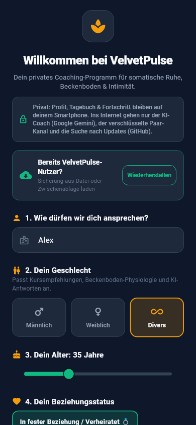
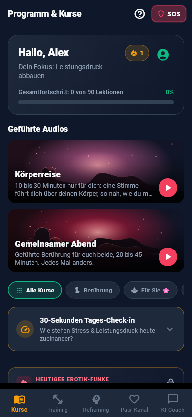
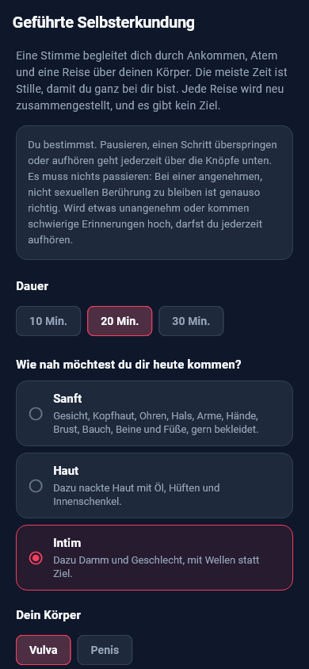
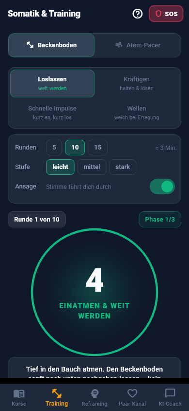
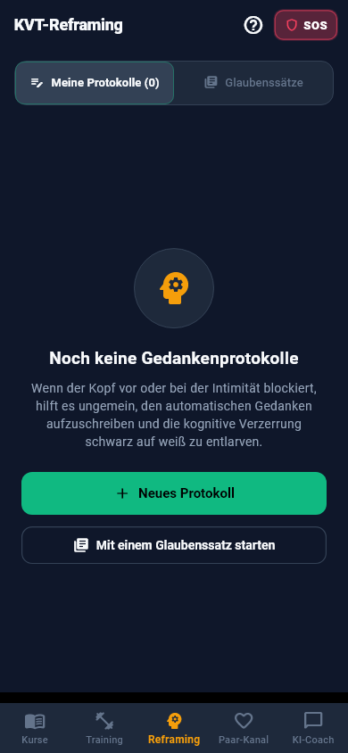
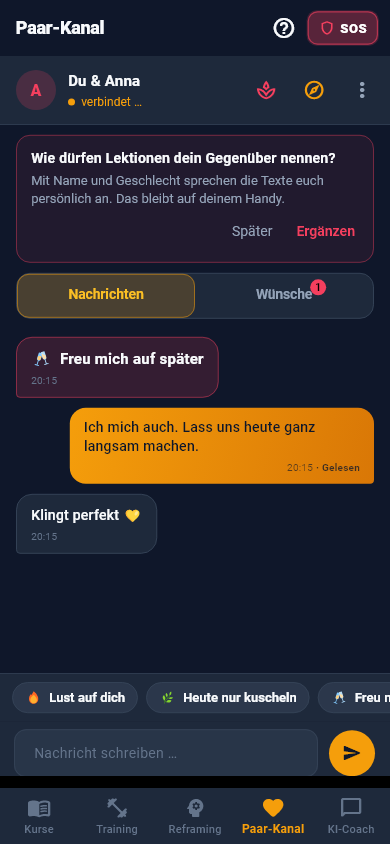
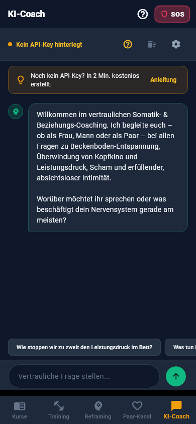
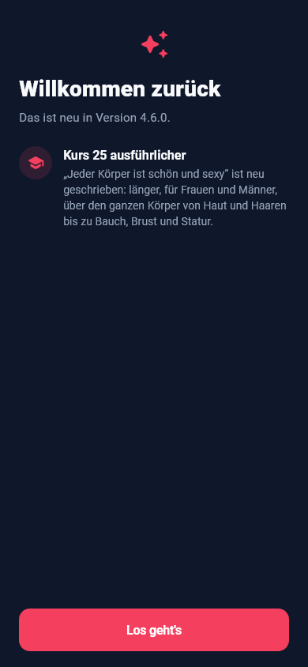

# How VelvetPulse works

This guide is also inside the app (question mark at the top right, or in your profile). [Deutsche Fassung](ANLEITUNG.md)

## Contents

- [Getting started](#getting-started)
- [Courses and lessons](#courses-and-lessons)
- [Guided audio](#guided-audio)
- [Training and quick help](#training-and-quick-help)
- [Reframing journal and check-in](#reframing-journal-and-check-in)
- [Couple channel](#couple-channel)
- [Spicy mode (18+)](#spicy-mode-18)
- [AI coach](#ai-coach)
- [Privacy, discretion and backup](#privacy-discretion-and-backup)
- [Updates and beta](#updates-and-beta)
- [Language and English recordings](#language-and-english-recordings)
- [Help and feedback](#help-and-feedback)

## Getting started

On first launch you create a small profile: name, gender, relationship status and your focus. The app uses it to choose suitable courses, voices and example questions. Everything stays on your phone.

You can reach your profile at any time via the person icon at the top of the start page. That's also where you'll find language, discretion, backup, spicy mode and updates.

## Courses and lessons

The Courses tab contains all courses, grouped into six focus areas: Foundations, Accepting and letting go, Discovering yourself, Desire as a couple, Touch, and Fantasy and play. Tapping a focus area opens its courses; at first the one matching your focus is open. Use the filters above to choose, for example, “For her”, “For him” or “For couples”.

Every lesson has a text, a recording to listen to and a question to reflect on at the end. Some lessons have a button at the bottom that takes you straight to the matching exercise, such as the pelvic floor timer or a guided audio.

Tapping “Mark as completed” counts towards your progress.

## Guided audio

The guided audios sit on the start page as a row to swipe through.

Body journey: 10 to 30 minutes just for you. You choose how close you want to come to yourself, and a voice guides you across your body. Most of the time is silence, so you can feel.

Shared evening: 20 to 45 minutes for two. You take turns giving and receiving, and a singing bowl marks the transitions. Agree on a stop word beforehand.

Falling asleep: 60, 90 or 120 minutes in bed, with a focus of your choice or as a surprise. The voice grows quieter and rarer, the sentences return in rounds, and in the end only a soft sound remains. You may fall asleep. Best with the charger plugged in; in discretion mode the card just says Relaxation.

Dream evening: 30, 45 or 60 minutes before sleep, with a dream image of your choice or as a surprise. The voice accompanies you into sleep, paints the dream image and quietly repeats a dream intention so it comes with you into the night. In spicy mode there is a more explicit version for your body. If you are prone to sleep paralysis, better leave out lucid exercises. In discretion mode the card just says Calm.

Dream journal: In the morning after a dream evening, a card asks „What do you remember?“. A few keywords and marks such as lucid or sensual are enough, and „Nothing remembered“ counts too. The journal is private and part of your encrypted backup; in discretion mode the card just says Morning note.

In the dream journal, „This week“ shows a calm overview without scores. Below it and on the dream evening setup page you can switch on reality checks: two to four reminders a day, neutrally worded „A brief moment for you“, off by default. In the dream evening, „Wake me tonight“ sets the clock app's alarm for that one night, at most twice a week; afterwards a voice accompanies you back to sleep.

Pleasure in dreams (spicy mode only): eight evenings that build on each other, from a pleasurable body as you fall asleep to the lucid, sensual dream. The next episode unlocks after two evenings. From episode three you choose your body in the dream and with whom pleasure may unfold. The recordings come as a separate package.

All of them are put together anew every time. You can pause, skip and stop at any time.

## Training and quick help

The Training tab contains the pelvic floor timer with four exercise types and spoken cues, plus the breathing pacer, for example for 4-7-8 breathing.

The SOS button at the top right helps in moments of pressure or anxiety, with short steps for before, in the moment and afterwards.

## Reframing journal and check-in

In the Reframing tab you write down distressing thoughts and examine them using the method of cognitive behavioural therapy: what happened, what did you think, what speaks for it, what against it, and how else could you see it?

The start page also has the 30-second check-in: how do stress and desire relate to each other today?

## Couple channel

In the couple channel you connect with your partner: by invitation straight from the app or via QR code. There's no account and no phone number, and messages are end-to-end encrypted. When both phones have a new version, messages travel sealed (NIP-17): the relays can no longer see who writes to whom and when. This happens by itself, and older versions keep working as before.

Sparks: with one tap you show what you're in the mood for today, or not.

Messages: with read receipts, which you can switch off in the menu.

Wishes: in the yes/maybe/no list, each of you votes separately. Only what you both want becomes visible.

Learning together: share lessons and exchange answers to the reflection questions.

## Spicy mode (18+)

You switch on spicy mode in your profile, only after confirming that you're an adult. It unlocks: the levels “Spicy” and “Extra spicy” in the body journey and the shared evening, courses 26 and 27, spicy lessons in other courses and additional questions in the yes/maybe/no list. The app also takes on a red look.

In the couple chat you get hot sparks, messages that disappear after reading, and photos that travel encrypted directly from phone to phone and can be viewed only once. To set up the connection, a public helper server (STUN, run by Google) sees your IP addresses, but never the photo. Photos are still experimental: on some mobile networks the direct connection can't be made. If a photo is waiting, the app keeps trying on its own while it's open; “Try again now” tries right away. If you like, you'll find a photo idea there every day, entirely optional and gone at once with “Not today”. Use the chat menu to invite your partner to spicy mode.

You can switch it off at any time, and everything from it disappears immediately.

## AI coach

The AI coach answers questions about desire, body and relationships. It uses Google Gemini with your own free key; the app explains step by step how to get one. Your questions go to Google, but not to us.

The example questions adapt to your profile.

## Privacy, discretion and backup

Everything you enter stays on your phone. Secrets such as keys are kept in Android's protected storage.

In your profile you can lock the app with your fingerprint; content is then also hidden in the app overview and screenshots are blocked. The discreet app icon shows a neutral name instead of VelvetPulse.

The app asks before playing through the speaker, and pauses if headphones are disconnected.

If you like, you can anonymously say “hello” once in your profile: It only transmits the app version and language, encrypted and without a sender, so we can roughly see whether the app is being used.

“Export backup” creates a password-protected backup that you can transfer to a new phone.

## Updates and beta

Under Profile › “Check for updates” the app finds new versions and installs them after you confirm. With the “Receive beta versions” switch you can test new features earlier. Every stable version sets the switch back to stable.

After an update, “What's new” shows once what has changed.

## Language and English recordings

The app is available in German and English. It follows your phone's language, and you can change it in your profile.

You download the recordings by Victoria and Martin in your profile under “Recordings”, split into lessons and guided audio, in German and in English. They're no longer inside the app itself, so it stays small and corrected recordings arrive without an update. If a recording is missing, your phone's voice reads aloud.

## Help and feedback

If a word in a recording sounds wrong, tap “Word mispronounced?” below the player. Send wishes and bug reports with “Send feedback” at the bottom of this page or in your profile: anonymous and encrypted over Nostr, no account needed. You can also report them publicly on GitHub.

The app is no substitute for medical or psychotherapeutic treatment. Where it makes sense, the lessons say explicitly when it's advisable to get checked.
