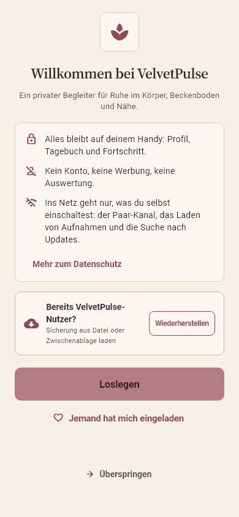
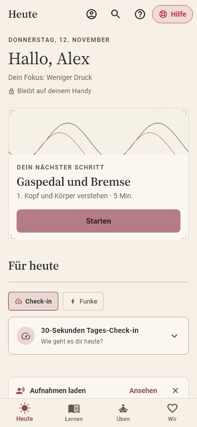
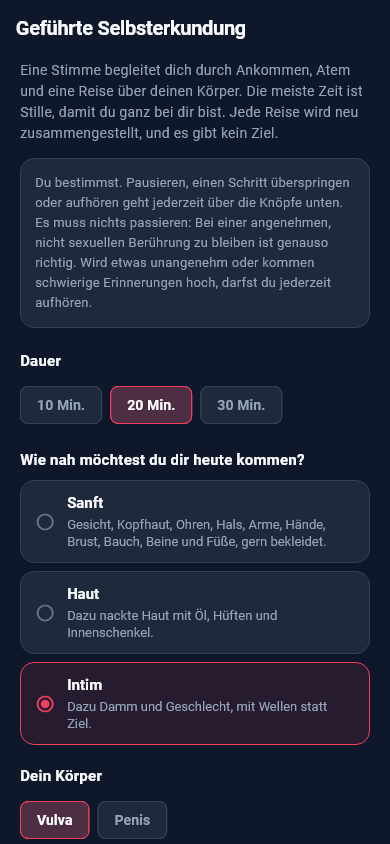
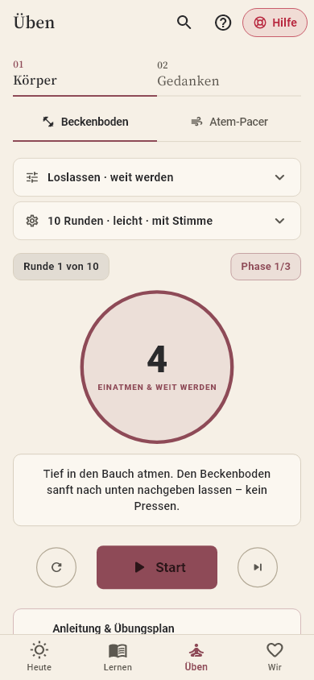
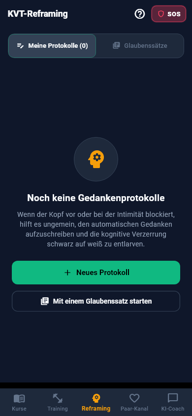
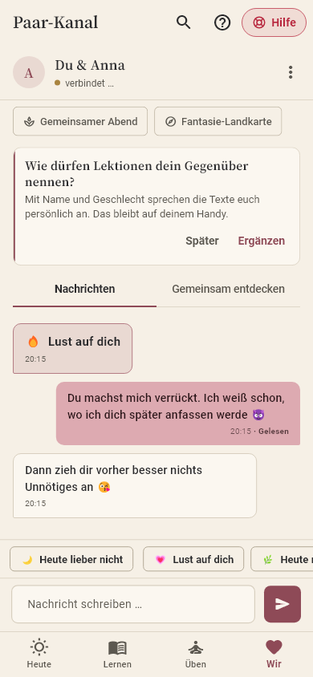
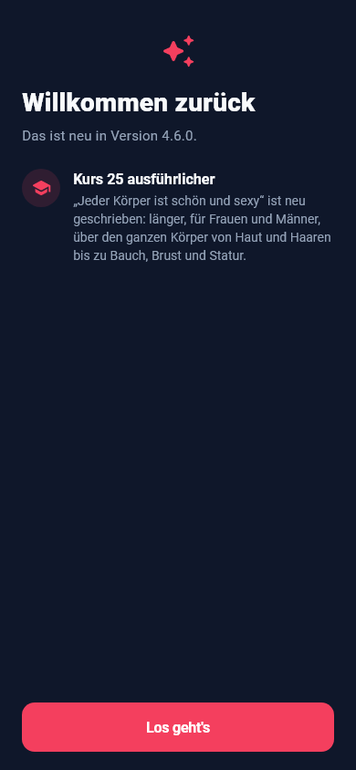

# How VelvetPulse works

This guide is also inside the app (question mark at the top right, or in your profile). [Deutsche Fassung](ANLEITUNG.md)

## Contents

- [Getting started](#getting-started)
- [Your first week together](#your-first-week-together)
- [Courses and lessons](#courses-and-lessons)
- [Find content and follow your personal path](#find-content-and-follow-your-personal-path)
- [Continue listening and share an experience](#continue-listening-and-share-an-experience)
- [Guided audio](#guided-audio)
- [Fantasies are free](#fantasies-are-free)
- [Training and quick help](#training-and-quick-help)
- [Reframing journal and check-in](#reframing-journal-and-check-in)
- [Couple channel](#couple-channel)
- [Spicy mode (18+)](#spicy-mode-18)
- [Privacy, discretion and backup](#privacy-discretion-and-backup)
- [Updates and beta](#updates-and-beta)
- [Language and English recordings](#language-and-english-recordings)
- [Appearance](#appearance)
- [Help and feedback](#help-and-feedback)
- [Compare sleep data](#compare-sleep-data)

## Getting started

On first launch you create a small profile: name, gender, relationship status and your focus. All questions are optional; for gender there is also “Not specified”, and nothing is preselected. The app uses it to choose suitable courses, voices and example questions. Everything stays on your phone.

Has someone invited you? Then tap “Someone invited me” right at the start. Three calm screens explain what this is about: nothing is a task, “no” is always an answer, and everything stays on your phone. After that you can set things up in peace, connect with that person, or just have a look first.

You can reach your profile at any time via the person icon at the top of the start page. That's also where you'll find language, discretion, backup, spicy mode and updates. In your profile you can also say, if you like, what your body is like. Exercises and audios use this to pick fitting voices and words; you can leave it empty and change it at any time.

## Your first week together

For couples who have just connected: seven small steps, one a day, at your own pace. You find the “Your first week” card in the Us tab. Each step is small, such as listening to something together or asking each other a question.

Every step has a “Not today”. The step then waits and nothing expires, and there are no points and no streaks. If you like, “Tell them where I am” sends one single sentence to your partner; that is entirely up to you.

Your progress stays on your phone and is part of your backup. You can fold the card away and show it again later.

## Courses and lessons

The Today tab is your start page. At the top is “Your next step”: the next open lesson, at first from the focus area matching your focus. Below it you choose between check-in and spark. If your focus is “Couple”, Today shows less at once: “Today, together” with your next steps and audios for the two of you, and, folded away under “More just for you”, everything you can use on your own. All courses are in the Learn tab, grouped into six focus areas: Foundations, Accepting and letting go, Discovering yourself, Desire as a couple, Touch, and Fantasy and play. Tapping a focus area opens its courses; at first the one matching your focus is open. Use the filters above to choose, for example, “With a vulva”, “With a penis” or “Together”.

Every lesson has a text, a recording to listen to and a question to reflect on at the end. Some lessons have a button at the bottom that takes you straight to the matching exercise, such as the pelvic floor timer or a guided audio.

Tapping “Mark as completed” counts towards your progress.

## Find content and follow your personal path

Use the magnifying glass at the top to find courses, lessons and practice activities. Search runs only on your device, saves no search history and does not search private notes or messages. Spicy content appears only when spicy mode is enabled.

The lesson player shows whether the specific recording is available offline. If it is missing, the device voice can read the text. “Download recordings” opens the existing package manager.

Lessons with a linked exercise and reflection question offer a personal path: discover the knowledge, try the exercise and reflect. You open and confirm each step yourself, with no time limit or required answer. You can return to a path from Today. Your place on the path is included in your backup.

## Continue listening and share an experience

Playback and continue listening: lessons and guided activities use one shared player. You can close the page and explore the app while a neutrally labelled mini player remains visible below. Reopening the app never starts playback by itself: you choose when to continue. Recordings resume at the saved section and position; a randomly assembled sequence is not regenerated. The device voice restarts a resumed section from the beginning. Your place is included in your backup.

Before and during playback you can see whether recordings are available offline. “Download recordings” opens the matching package manager, including the original language of a saved sequence. Missing content packages can be downloaded again.

Listen together: both of you open the app with a connected couple channel. Choose “Listen together” in the player. Your partner receives a neutral invitation that does not start audio. After accepting, each person explicitly confirms “Ready”. Both devices need the same recordings and sequence; actual files are compared. A shared countdown then begins. Either person can pause or end the activity at any time. Resuming needs both people to be ready again. Different complementary perspectives of an audio story are not synchronised yet.

If the connection is interrupted, your own recording continues locally. A remote pause cannot be delivered without a connection; you can always pause locally. Reconnecting never starts playback automatically. Spicy activities require the mode to be enabled on both devices.

Shared reflection is optional. You can choose a feeling and explicitly save and share your answer. Answers are revealed only after both people have shared. A failed send does not reveal anything early. Reopen a reflection from its message in the couple channel. Spicy reflections remain behind the mode.

## Guided audio

On the Today tab the guided audios are sorted by occasion: “For today” at the top is a suggestion based on the time of day, followed by the other groups. “For me” holds the body journey and dream practice, “For us” the shared evening and listening together, “Night” falling asleep, the dream evening, getting back to sleep and Pleasure in dreams, “Stories” the inner views. “Show all” opens the full list. The “Guided audio” bar folds the area in and out; the app remembers your choice.

Body journey: 10 to 30 minutes just for you. You choose how close you want to come to yourself, and a voice guides you across your body. Most of the time is silence, so you can feel.

Shared evening: 20 to 45 minutes for two. You take turns giving and receiving, and a singing bowl marks the transitions. Agree on a stop word beforehand.

Falling asleep: 60, 90 or 120 minutes in bed, with a focus of your choice or as a surprise. The voice grows quieter and rarer, the sentences return in rounds, and in the end only a soft sound remains. You may fall asleep. Best with the charger plugged in; in discretion mode the card just says Relaxation.

Dream evening: 30, 45 or 60 minutes before sleep, with a dream image of your choice or as a surprise. The voice accompanies you into sleep, paints the dream image and quietly repeats a dream intention so it comes with you into the night. In spicy mode there is a more explicit version for your body. If you are prone to sleep paralysis, better leave out lucid exercises. In discretion mode the card just says Calm.

Dream journal: In the morning after a dream evening, a card asks „What do you remember?“. A few keywords and marks such as lucid or sensual are enough, and „Nothing remembered“ counts too. The journal is private and part of your encrypted backup; in discretion mode the card just says Morning note.

In the dream journal, „This week“ shows a calm overview without scores. Below it and on the dream evening setup page you can switch on reality checks: two to four reminders a day, neutrally worded „A brief moment for you“, off by default. In the dream evening, „Wake me tonight“ sets the clock app's alarm for that one night, at most twice a week; afterwards a voice accompanies you back to sleep.

Pleasure in dreams (spicy mode only): eight evenings that build on each other, from a pleasurable body as you fall asleep to the lucid, sensual dream. The next episode unlocks after two evenings. From episode three you choose your body in the dream and with whom pleasure may unfold. The recordings come as a separate package.

All of them are put together anew every time. You can pause, skip and stop at any time.

Inner views (spicy mode only, 18+): continuous audio stories of about 15 to 25 minutes, not for falling asleep. They tell an encounter from the inside. You choose Soft, Spicy or Extra spicy and a perspective; the matching perspective of the same encounter follows the same sequence of scenes, so two people can listen together. “Listen together” synchronises the same version on two devices. Different complementary perspectives still need to be coordinated by you. The “Threesome” episodes have three perspectives in all three levels and are listened to on your own. All characters are adults, everything happens by mutual consent, and none of it is a benchmark: every body experiences pleasure differently. The recordings come as a separate package and then play without a network. In the player you can pause and skip scenes. If you tap the scene picture or choose “View pictures” on the episode, you see the pictures full screen: swipe between scenes, zoom with two fingers, pick the level. With the discreet app icon there are no pictures. On the card, discreet mode only shows Audio story.

Your dream practice: In Pleasure in dreams, connect recall, recognising dreams and noticing what lingers during the day. Under “Your dream signs”, add, edit or delete personal signs. For your evening preparation, choose a sign and a pleasant memory from your journal. Under “Reflect on today”, optionally record rest, waking desire, sensual or lucid dreams, any experienced orgasms and a note. Questions can remain unanswered. Your private review lets you view, edit and delete daily observations. Signs and observations stay local, are included in your backup and are not sent to your partner and never leave your device. More waking desire is an aim to explore, not a promised effect. For listening there are three short guided pieces for evening, clarity and morning, with Victoria or Martin. They are part of the guided recordings you download, and are for you alone.

## Fantasies are free

Whatever comes to mind while you listen, read or daydream belongs to you. A fantasy isn't a wish you have to act on, and it isn't a verdict on your relationship. It can even include things you'd never want in real life. Whether you share any of it, and what and when, is up to you. Your journal and your dreams stay on this device and in backups you make yourself; your partner only sees what you deliberately send in the couple channel, and the app lock in your profile adds extra protection from curious eyes.

## Training and quick help

The Practice tab, under Body, contains the pelvic floor timer with four exercise types and spoken cues, plus the breathing pacer, for example for 4-7-8 breathing.

The “Help” button at the top right opens a calm sheet. You choose what is going on: nervous, my body isn't going along, pain, “I don't want to go on”, my partner is quiet, afterwards. You get a few steps and sentences you can say.

There you also find help when a no isn't respected or there is pressure, with contacts for Germany, Austria, Switzerland, the United Kingdom and the USA. “Leave quickly” closes the sheet at once.

Questions about body and desire are answered by the lessons under Learn. For pain or lasting difficulties, see your doctor; for conflict or pressure, a counselling service.

## Reframing journal and check-in

In the Practice tab, under Thoughts, you write down distressing thoughts and examine them using the method of cognitive behavioural therapy: what happened, what did you think, what speaks for it, what against it, and how else could you see it?

The start page also has the 30-second check-in: how do stress and desire relate to each other today?

## Couple channel

In the couple channel you connect with your partner: by invitation straight from the app or via QR code. There's no account and no phone number, and messages are end-to-end encrypted. When both phones have a new version, messages travel sealed (NIP-17): the relays can no longer see who writes to whom and when. This happens by itself, and older versions keep working as before.

Sparks: with one tap you show what you're in the mood for today, or not. “Not today” is always one tap away. The other person can answer “Not today” and “Let's talk” with “Thanks for telling me”.

Spicy invitation: whoever is invited can answer “Not right now”, no explanation needed.

Disconnecting: in the menu you disconnect, after two confirmations. Your partner gets a calm notice (you can switch it off and disconnect quietly) and decides for themselves whether to delete this connection's data too. If the notice doesn't arrive (app closed, no connection), everything there stays until they delete it themselves. Sent messages and photos can't be taken back.

Messages: with read receipts, which you can switch off in the menu.

Explore together: in the fantasy map each of you answers separately with “Yes, please”, “Maybe” or “Rather not”. Under “My answers” you only see your own. Under “Together” only what you both want appears; a “Maybe” shows up there to talk about, a “Rather not” never does. While there is no overlap yet, it stays quiet, without cheering and without pressure. In spicy mode there are also scenes to try, whole evenings that you answer the same way.

Learning together: share lessons and exchange answers to the reflection questions.

## Spicy mode (18+)

You switch on spicy mode in your profile. For that you enter the month and year you were born (the app only calculates and does not store the date) and confirm your device lock once (PIN, pattern or fingerprint). Without a screen lock set up, the mode is not available. After an app restart or 5 hours in the background, the app asks for the device lock again; if the time in the background has run out, it tells you when you come back and offers to unlock again. You can turn off the repeated check in your profile. Anyone who enters an age under 18 is locked out for a while. Everything stays on your device, there is no ID check and no third-party service. It unlocks: the levels “Spicy” and “Extra spicy” in the body journey and the shared evening, courses 26 and 27, spicy lessons in other courses and additional questions in the yes/maybe/no list. The app also takes on a red look.

In the couple chat you get hot sparks, messages that disappear after reading, and photos that travel encrypted directly from phone to phone and can be viewed only once. To set up the connection, a public helper server (STUN, run by Google) sees your IP addresses, but never the photo. Photos are still experimental: on some mobile networks the direct connection can't be made. If a photo is waiting, the app keeps trying on its own while it's open; “Try again now” tries right away. If you like, you'll find a photo idea there every day, entirely optional and gone at once with “Not today”. Use the chat menu to invite your partner to spicy mode.

You can switch it off at any time, and everything from it disappears immediately.

## Privacy, discretion and backup

Everything you enter stays on your phone. Secrets such as keys are kept in Android's protected storage.

The app lock is on by default: during setup the app turns it on if your phone has a screen lock. It then asks for your fingerprint, face, PIN or pattern when you open it and after one minute in the background; content is also hidden in the app overview and screenshots are blocked. If you used VelvetPulse before, you are asked once whether the app should be locked. You can turn the lock off or back on in your profile at any time. The discreet app icon shows a neutral name instead of VelvetPulse.

The app asks before playing through the speaker, and pauses if headphones are disconnected.

If you like, you can anonymously say “hello” once in your profile: It only transmits the app version and language, encrypted and without a sender, so we can roughly see whether the app is being used.

“Export backup” creates a password-protected backup that you can transfer to a new phone.

## Updates and beta

Under Profile › “Check for updates” the app finds new versions and installs them after you confirm. With the “Receive beta versions” switch you can test new features earlier. Every stable version sets the switch back to stable.

After an update, “What's new” shows once what has changed.

## Language and English recordings

The app is available in German and English. It follows your phone's language, and you can change it in your profile.

You download the recordings by Victoria and Martin in your profile under “Recordings”, split into lessons and guided audio, in German and in English. They're no longer inside the app itself, so it stays small and corrected recordings arrive without an update. If a recording is missing, your phone's voice reads aloud.

## Appearance

Under Profile and settings you choose “Appearance”: Paper (light, default), Night paper (dark) or Classic (the previous colours). The choice applies to the whole app straight away and is part of your backup.

Spicy mode has its own colours: deep burgundy and plum with warm paper white. Where an illustration is still missing, a drawn placeholder appears.

Course, audio and topic images use existing pencil drawings or restrained graphic compositions. More intense Spicy illustrations come from the course image pack and appear only in Spicy mode. Until the pack is downloaded, the regular image remains visible. The view updates automatically after installation.

## Help and feedback

If a word in a recording sounds wrong, tap “Word mispronounced?” below the player. Send wishes and bug reports with “Send feedback” at the bottom of this page or in your profile: anonymous and encrypted over Nostr, no account needed. You can also report them publicly on GitHub.

The app is no substitute for medical or psychotherapeutic treatment. Where it makes sense, the lessons say explicitly when it's advisable to get checked.

## Compare sleep data

In Practice, open Dream Practice to find the optional sleep-data comparison. On Android 14 or later, you can allow Health Connect to read sleep records. Your watch or its app must first sync its data to Health Connect. Dream Practice remains fully usable without a wearable.

Import runs only when you request it and reads the past 30 days. If several sources are available, select one. The app displays its recorded time window and available sleep stages alongside your own observations. A time window is not necessarily actual sleep duration; measurements are estimates and do not establish an effect of the exercises. There is no live detection or overnight signalling.

Disconnecting keeps previously imported records. Use “Delete imported sleep data” to remove them separately; your journal and personal observations remain. Revoke Android access in Health Connect settings. Imported copies are included in local backups; restoring a backup does not automatically connect the new device. Changes or deletions in the source app are not applied automatically.

The “What your nights reveal” reflection brings together the past seven days, your dream journal and your daily observations. It shows reported lucidity, sensuality and any available sleep measurements together. Entries are matched by date, not treated as precisely measured dream times. An optional invitation leads to your journal or evening practice. Missing observations remain unknown; when entries suggest distress, rest takes priority.
